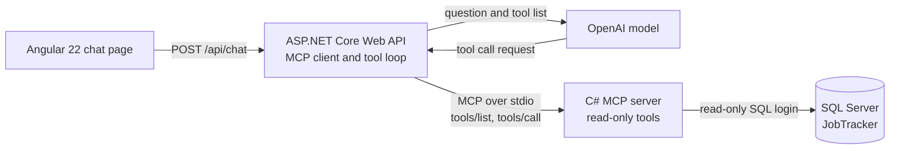

# Job Tracker MCP

Ask questions about your job applications in plain English and get answers from your own SQL Server database.

The project is a small, complete example of the Model Context Protocol (MCP): a C# MCP server exposes database tools, a .NET Web API connects an OpenAI model to those tools, and an Angular chat page sits on top.

> Add a screenshot of the chat page here, for example `docs/chat-page.png`.

## How it works



1. The user types a question in the Angular page.
2. The Web API sends the question and the list of MCP tools to the model.
3. The model decides which tool to call. It never runs anything itself.
4. The API runs the tool through the MCP client. The MCP server queries the database and returns the rows.
5. The result goes back to the model, which writes the answer. This repeats up to 5 times per question.

## Tools exposed by the MCP server

| Tool | What it does |
| --- | --- |
| `get_application` | Returns one application by its Id. |
| `list_applications` | Lists applications, newest first, with an optional status filter. At most 50 rows. |
| `get_followups_due` | Lists open applications whose follow-up date is today or earlier. Rejected and Withdrawn are left out. |
| `say_hello` | A health check for the server. |

## Safety design

- The server connects with a dedicated SQL login (`mcp_reader`) that can only read. Insert, update, delete and alter are explicitly denied.
- Every query is fixed and parameterised. There is no "run any SQL" tool.
- Results are capped at 50 rows, and the model is limited to 5 tool calls per question.
- Secrets are read from environment variables. Nothing secret is stored in the code or in Git.
- The OpenAI key stays in the Web API. The browser never sees it.
- CORS allows only the Angular dev address.

## Tech stack

| Part | Technology |
| --- | --- |
| MCP server | C#, .NET 10, ModelContextProtocol SDK, Microsoft.Data.SqlClient |
| API | ASP.NET Core Web API, Microsoft.Extensions.AI, OpenAI |
| UI | Angular 22, TypeScript, signals, Vitest |
| Database | SQL Server |
| Tests | xUnit, Vitest, a fixed AI question set |

## Project layout

| Folder | Purpose |
| --- | --- |
| `JobTrackerMcp` | The MCP server and its database tools. |
| `JobTrackerMcp.Tests` | xUnit tests for the tools. |
| `JobTrackerHost` | A console host. It also runs the fixed question set (`dotnet run -- eval`). |
| `JobTrackerApi` | The Web API that connects the model to the MCP server. |
| `job-tracker-ui` | The Angular chat page. |
| `sql` | Database setup script with sample data. |

## Run it locally

**You need:** .NET 10 SDK, Node.js (22.22.3 or later, 24.15.0 or later, or 26), Angular CLI 22, SQL Server and an OpenAI API key.

1. **Create the database.** Open `sql/01_JobTracker_Setup.sql`, change the password on the `CREATE LOGIN` line, then run:

   ```
   sqlcmd -S localhost -E -C -i sql\01_JobTracker_Setup.sql
   ```

2. **Set environment variables.** Restart your terminal and editor afterwards.

   | Name | Value |
   | --- | --- |
   | `JOBTRACKER_CONNECTION` | `Server=localhost;Database=JobTracker;User Id=mcp_reader;Password=<your password>;TrustServerCertificate=True;` |
   | `OPENAI_API_KEY` | Your OpenAI key |
   | `OPENAI_MODEL` | Optional. Defaults to `gpt-4o-mini`. |

3. **Build the MCP server.** The API starts it as a child process.

   ```
   dotnet build JobTrackerMcp
   ```

   If you keep the repo in another folder, set `ServerProject` in `JobTrackerApi/appsettings.json` to the full path of `JobTrackerMcp.csproj`.

4. **Start the API.**

   ```
   cd JobTrackerApi
   dotnet run --launch-profile http
   ```

   Swagger is at http://localhost:5195/swagger.

5. **Start the Angular app.**

   ```
   cd job-tracker-ui
   npm install
   ng serve
   ```

   Open http://localhost:4200.

## Tests

| Command | What it checks |
| --- | --- |
| `dotnet test JobTrackerMcp.Tests` | The database tools, against the sample data. |
| `cd job-tracker-ui` then `ng test --watch=false` | The chat page and the HTTP service, with fakes. |
| `cd JobTrackerHost` then `dotnet run -- eval` | Five fixed questions. Checks that the model picks the right tool and gives the right facts. |

Run the question set after any change to a tool description, the system prompt or the model.

## Known limits and next steps

- Each question is answered on its own, with no memory of earlier ones.
- The API has no sign-in. It is meant for local use until authentication is added.
- Planned: conversation memory, then deployment to Azure (Azure SQL, App Service or Container Apps, Key Vault, Application Insights, Azure Pipelines).
